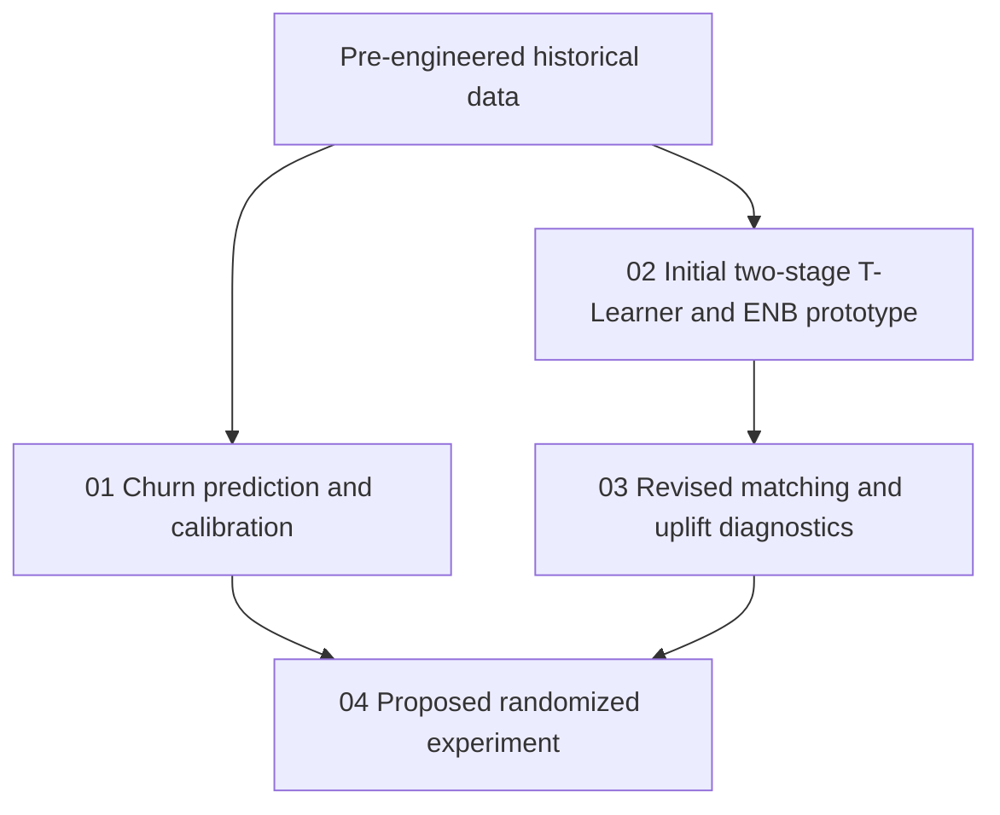
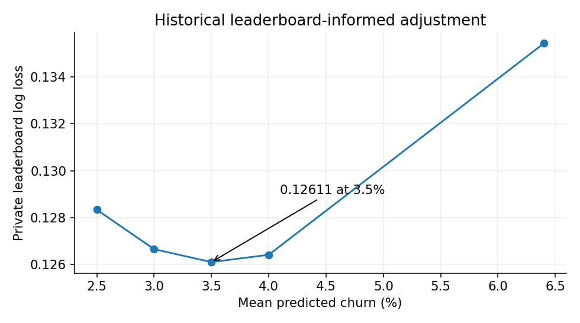
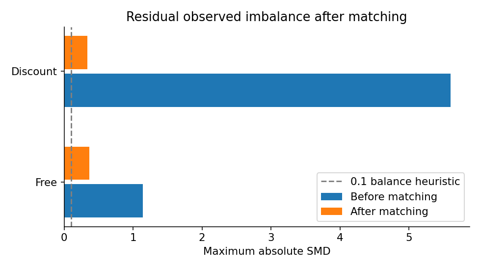
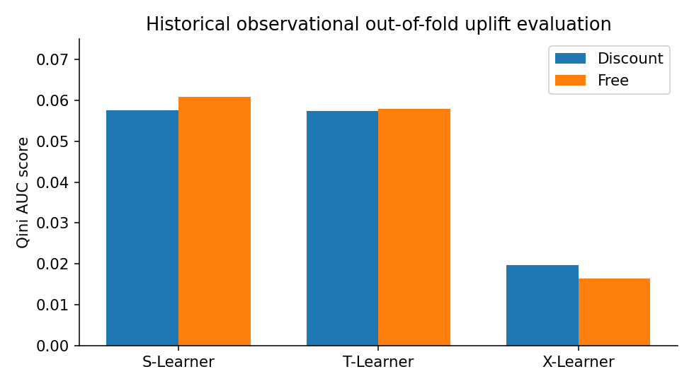

# KKBOX Churn Prediction & Causal Decision Framework

**Applied machine learning · Causal inference · Decision science · Experimental design**

A five-student course project for Manufacturing Data Science at National Taiwan University, using the WSDM Cup 2018 KKBOX Churn Prediction Challenge dataset. This portfolio edition presents selected historical implementations and results, reorganized for readability.

## Overview

Churn risk alone does not establish whether a retention incentive will change a customer's behavior. We explored how calibrated risk predictions, treatment-effect models, and expected net benefit could inform subsidy allocation. We then audited the observational evidence and found that individualized recommendations were not sufficiently credible for deployment. Our final proposal was to use risk scores for experimental eligibility and validate interventions through randomization.

## My Contributions

This was a five-person team project. I led the design and evaluation of the subsidy decision framework, with a particular focus on assessing whether observational evidence could support individualized intervention decisions.

**Primary responsibilities**

- Defined proxy treatment groups (no subsidy, discount, and free trial) from historical transaction records and developed the initial two-stage T-Learner and individualized expected net benefit (ENB) framework.
- Designed and implemented the revised propensity score matching analysis, excluding direct payment-derived treatment signals, and examined common support and covariate balance using standardized mean differences (SMD).
- Implemented S-, T-, and X-Learners to investigate heterogeneous treatment-effect estimates to support the assessment of individualized uplift rankings. Based on the matching and uplift diagnostics, I recommended against direct deployment of the initial policy.
- Led the design of a proposed stratified randomized experiment, using churn-risk scores and engagement criteria to define candidate users and comparing no subsidy, discount, and free trial. The experiment was not conducted.

**Collaborative work and attribution**

- Co-developed the XGBoost and LightGBM prediction models, weighted ensemble, and probability calibration; collaborated on Qini evaluation, break-even analysis, and sensitivity analysis.
- Other team members were responsible for upstream data processing and temporal feature engineering. The reported data scale, feature counts, and predictive performance describe team-level results, not solely my individual work.

## Project at a glance

| Item | Historical result |
|---|---:|
| Raw data scale | Approximately 30 GB |
| Later prediction training cohort | 937,817 users |
| Later prediction features | 78 |
| Ensemble OOF log loss | 0.17406 |
| OOF log loss after fitted Platt scaling | 0.17400 |
| Private leaderboard log loss before / after base-rate adjustment | 0.13542 / 0.12611 |
| Inferred discount / free treatment counts | 654 / 1,998 |

The 0.12611 score is the result documented in the final report. The target base rate was selected using leaderboard feedback; it is **not** a fully independent test estimate. Historical scores have not been independently reproduced in this portfolio edition.

## Workflow

The early prototype and later diagnostic pipeline use different feature-table versions (155 and 78 features, respectively). Their inputs and treatment definitions are documented separately; they are not interchangeable.

## Selected implementations

| Notebook | Contents |
|---|---|
| [01 — Churn prediction](notebooks/01_churn_prediction.ipynb) | Temporal cohorts, stratified cross-validation, XGBoost–LightGBM ensemble, Platt scaling and logit adjustment |
| [02 — Initial decision framework](notebooks/02_initial_decision_framework.ipynb) | Two-stage matching, separate outcome models, estimated uplift and sequential ENB rules |
| [03 — Causal diagnostics](notebooks/03_causal_diagnostics.ipynb) | Payment-variable exclusions, caliper matching, covariate balance, S/T/X-Learners, Qini and cost sensitivity |
| [04 — Experiment design](notebooks/04_experiment_design.ipynb) | Risk-based eligibility, sample-size approximation and proposed stratified randomization |

## Key findings

### Predictive performance

The later ensemble combined XGBoost and LightGBM with weights selected on out-of-fold predictions. Platt scaling was fitted on the same OOF predictions. A logit adjustment to a 3.5% mean prediction improved the reported private leaderboard score, reflecting sensitivity to the assumed target base rate rather than an established improvement in discrimination.

### Why the initial decision prototype was not deployable

The early two-stage T-Learner used payment-derived outcome features and estimated net benefit under assumed customer values and subsidy costs. In the later diagnostic cohort, inferred treatment was sparse (about 0.28% combined), and matching reduced but did not eliminate observed imbalance.

| Inferred treatment | Maximum absolute SMD before | Maximum absolute SMD after | Matched churn-rate difference* |
|---|---:|---:|---:|
| Discount | 5.5992 | 0.3341 | +3.37 pp |
| Free | 1.1396 | 0.3677 | -3.61 pp |

*Control minus treated churn rate, not an identified causal effect. The matched contrast targets matched treated users rather than the population ATE. Residual imbalance, treatment timing and unmeasured confounding limit interpretation.

Out-of-fold Qini scores ranged from 0.0164 to 0.0608 across S-, T- and X-Learners under the observational evaluation design. No external benchmark is assumed. These scores, together with the data limitations, did not support direct deployment of an individualized policy.

### Revised recommendation

Use the churn model to select high-risk, recently active users for a proposed three-arm randomized experiment: no subsidy, discount, and free trial. Prespecify stratification, primary outcomes, sample size, and economic guardrails. The historical full-pipeline filter yielded approximately 167,423 candidate users, with 29.1% observed churn; these are retrospective, in-sample planning estimates, not proof of persuadability or prospective performance. The experiment was proposed, not conducted.

## Repository scope and reproducibility

The notebooks start from pre-engineered feature tables. Raw-data preprocessing scripts, processed datasets, and trained model files are not included. The original two-stage feature list is recovered from the saved notebook output. The portfolio notebooks have been statically checked but not rerun with the original data. Selected aggregate historical results are retained in text and figures; row-level predictions and user identifiers are not published.

See [data requirements](data/README.md), [feature engineering](docs/feature_engineering.md), and [methodology and limitations](docs/methodology.md). To run with the required original artifacts, install dependencies with `pip install -r requirements.txt` in an isolated environment, then open the notebooks from the repository root or the `notebooks/` directory. Run notebook 01 before notebook 04. Notebooks 02 and 03 use their own respective input schemas. Dependency versions are not pinned because the original environment was not supplied.

## Acknowledgments

This work originated as a five-person team project at National Taiwan University. The dataset was provided through the WSDM Cup 2018 KKBOX challenge. The later feature engineering approach was informed by [Bryan Gregory's winning solution (arXiv:1802.03396)](https://arxiv.org/abs/1802.03396). This repository documents academic work and is not an official KKBOX product or a production intervention system.
